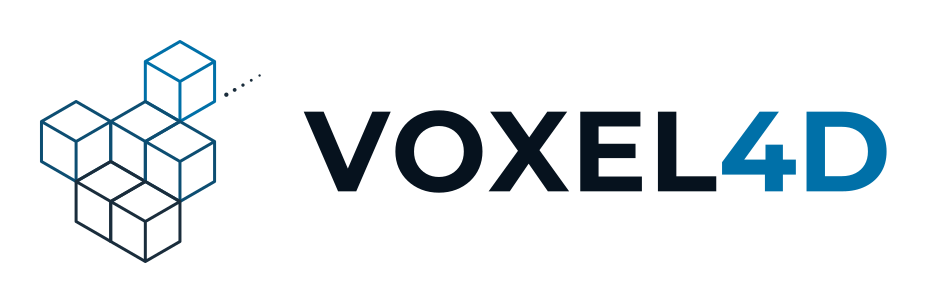

<picture>
  <source media="(prefers-color-scheme: dark)" srcset="./assets/voxel4d-horizontal-dark.svg">
  
</picture>

# VOXEL4D

A VOXEL4D desenvolve uma plataforma para organizar, visualizar e compartilhar levantamentos e inspeções de campo.

Reúna ortofotos, nuvens de pontos, registros de obra e relatórios em um projeto. A equipe e o cliente podem consultar o material pelo navegador e comparar registros de datas diferentes.

Trabalhamos com equipes de engenharia, aerolevantamento e acompanhamento de obras.
